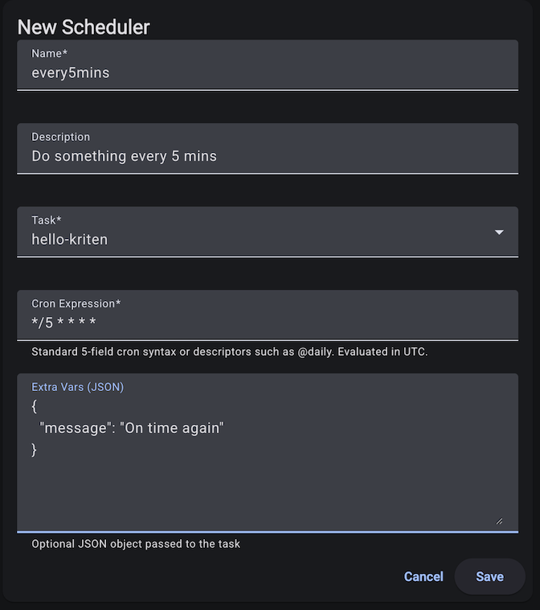

# Scheduler

Any task in Kriten can be executed on repeatable schedule.

*API documentation is available via swagger $KRITEN_URL/swagger/index.html*

where $KRITEN_URL is set to the URL of your Kriten instance.

## Configure scheduler for Kriten task



|Key| Description |
|---------|-----------|
|`name`| unique name of the cronjob object|
|`task`| existing task name to be executed on schedule|
|`schedule`| schedule based on Cron syntax|
|`disabled`| boolean true or false - disables cronjob, default is set to false|
|`extra_vars`| input parameters, exposed to custom code via EXTRA_VARS env var as json string|


* Cron syntax:

```console
# ┌───────────── minute (0 - 59)
# │ ┌───────────── hour (0 - 23)
# │ │ ┌───────────── day of the month (1 - 31)
# │ │ │ ┌───────────── month (1 - 12)
# │ │ │ │ ┌───────────── day of the week (0 - 6) (Sunday to Saturday)
# │ │ │ │ │                                   OR sun, mon, tue, wed, thu, fri, sat
# │ │ │ │ │
# │ │ │ │ │
# * * * * *
```


