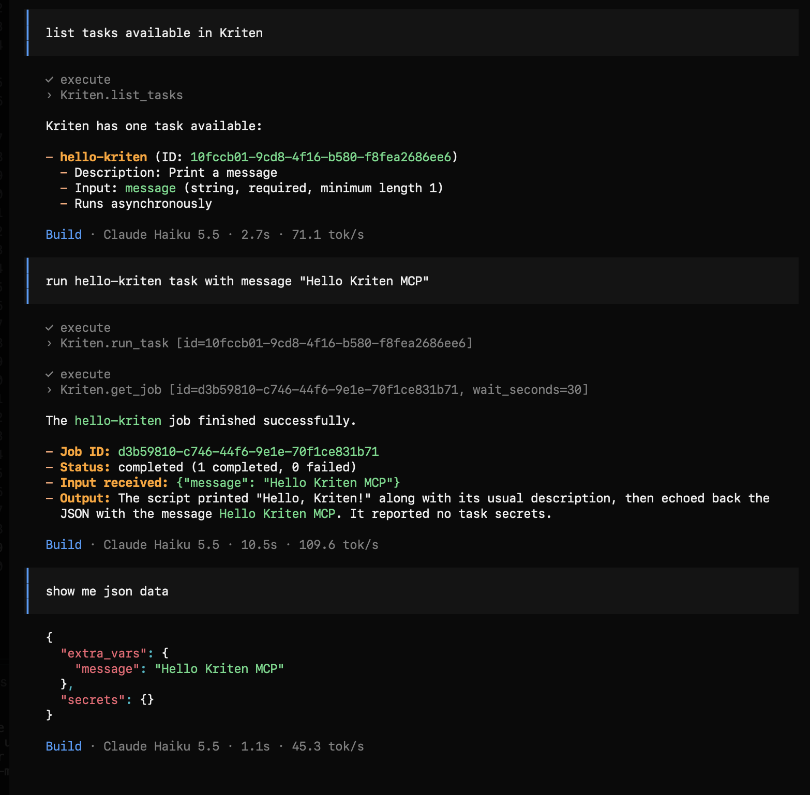

# Kriten MCP (Model Context Protocol)

MCP has been integrated into Kriten from version 1.1.0. That enables AI agents to execute scripts available as Kriten tasks with same controls (authentication, RBAC, audit) as via Rest API endpoint or UI.

## Installation

MCP is disabled by default, you need to enable it at Kriten installation.

There is a set of parameters for MCP exposed via Helm chart:

```sh
# MCP parameters
MCP_ENABLED = true
MCP_STDOUT_LIMIT = 65536
MCP_MAX_WAIT_SECONDS = 30
MCP_POLL_INTERVAL_MS = 2000
```

## MCP endpoint

MCP is available at ```/api/v1/mcp```. 

As example, if Kriten is installed as kriten.example.com resolvable DNS name, then MCP URL would be http://kriten.example.com/api/v1/mcp .

Trying to access it via Web browser, HTTP status would be 404 if MCP is not enabled, otherwise HTTP code 401 Unauthorized.


## Transport and Authentication

Kriten MCP implements Streamable HTTP with static API Token authentication.

Example, OpenCode config:

```json
{
  "$schema": "https://opencode.ai/config.json",
  "mcp": {
    "Kriten": {
      "type": "remote",
      "url": "http://kriten.example.com/api/v1/mcp",
      "oauth": false,
      "headers": {
        "Authorization": "Bearer <kriten api token>"
      }
    }
  } 
}
```

How to create API token, see User Guide.

## Tools available

The Kriten MCP server exposes four tools, all called through execute under tools.Kriten:
1. ```list_tasks()```: Lists the tasks available to you that have an input schema, with their descriptions.
2. ```get_task({ id })```: Returns one task's description and input schema, which you need to know what extra_vars to pass.
3. ```run_task({ id, extra_vars? })```: Runs a task. extra_vars must match the task's schema. Returns a job ID and initial status.
4. ```get_job({ id, wait_seconds? })```: Returns a job's status, completed and failed counts, failure reason, stdout, and any JSON output. Use wait_seconds to wait for a running job to finish.

A typical flow is ```list_tasks``` → ```get_task``` → ```run_task``` → ```get_job```.

## Tasks auto-discovery and RBAC

Any new task created in Kriten becomes immediately available for the AI agent to auto-discovery via ```list_tasks()```. AI Agent would only see tasks which have OpenAPI schema and if a Kriten user behind given API token has RBAC permission to "execute" task.

Example of "hello-kriten" task in Kriten, (see examples in git repository https://github.com/kriten-io/kriten-community-toolkit.git). This a simple Python script demonstrating Kriten capabilities, it prints out provided Extra Vars and Secrets.

We should apply OpenAPI schema to it for AI Agent to see it and to understand parameters:

```json
{
  "description": "Print a message",
  "properties": {
    "message": {
      "minLength": 1,
      "type": "string"
    }
  },
  "required": [
    "message"
  ]
}
```

Simple schema, which requires only one parameter, called "message".

This a demonstration of that capability from OpenCode:


